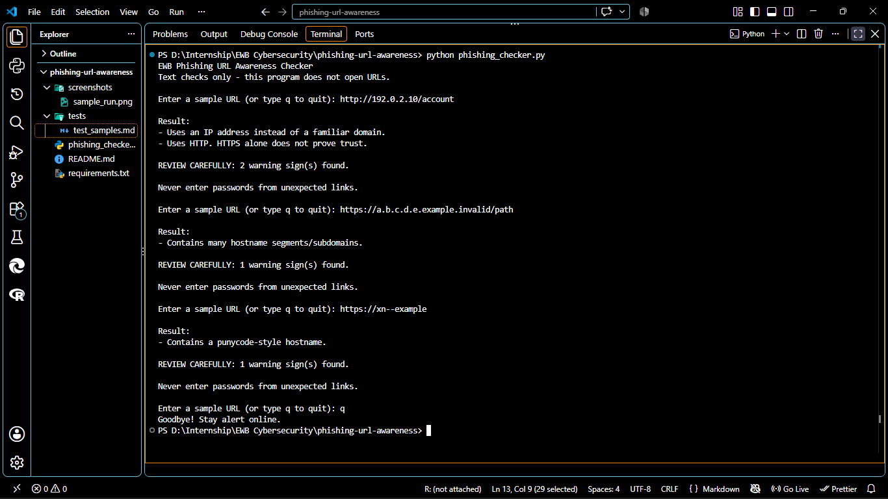
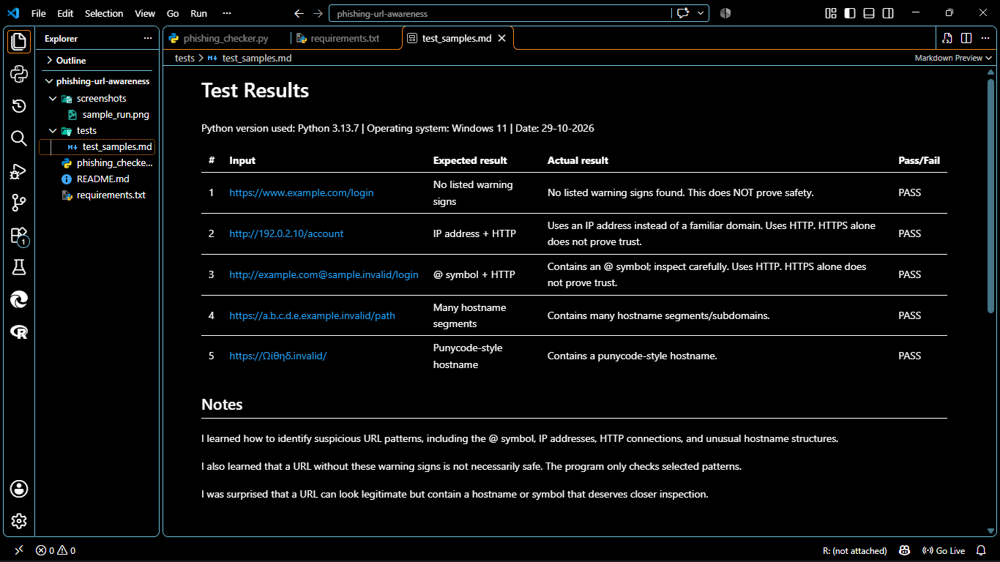

# EWB Phishing URL Awareness Checker

## Overview

Phishing is a cyberattack in which criminals use fake links or
messages to trick people into sharing sensitive information.
The EWB Phishing URL Awareness Checker is a Python program that
checks URL text for selected warning signs without opening the
website.

## Features

- Detects the @ symbol in a URL.
- Flags unusually long URLs (over 100 characters).
- Identifies IP-address hostnames.
- Detects many hostname segments (5 or more).
- Flags punycode-style hostnames containing `xn--`.
- Detects the HTTP scheme.
- Handles empty and malformed URL input.
- Allows users to inspect multiple URLs in one session.
- Displays a review warning when suspicious patterns are found.
- Works offline without external packages or API keys.

## Requirements

- Python 3.10 or later.
- No additional Python packages are required.

## Project Structure

```text
phishing-url-awareness/
├── phishing_checker.py
├── README.md
├── requirements.txt
├── tests/
│   └── test_samples.md
└── screenshots/
    ├── sample_run.png
    └── test_results.png
```

## How to Run

1. Install Python 3.10 or later.
2. Open the project folder in VS Code.
3. Open a terminal in the project folder.
4. Run the following command on Windows:

   `python phishing_checker.py`

   On macOS or Linux, use:

   `python3 phishing_checker.py`

5. Enter a sample URL and press Enter.
6. Type `q` to quit the program.

## Example Output

```text
EWB Phishing URL Awareness Checker
Text checks only - this program does not open URLs.

Enter a sample URL (or type q to quit):
http://192.0.2.10/account

Result:
- Uses an IP address instead of a familiar domain.
- Uses HTTP. HTTPS alone does not prove trust.

REVIEW CAREFULLY: 2 warning sign(s) found.
```

## Testing

Five sample URLs are documented in
`tests/test_samples.md`.

The tests cover:

1. A standard HTTPS example URL.
2. An IP address with HTTP.
3. An @ symbol with HTTP.
4. A hostname with many segments.
5. A punycode-style hostname.

The actual test results must be verified by running the
program on the local computer.

## Improvements

1. **Repeated URL checking:** Added a loop so users can inspect
   multiple URLs without restarting the program. Typing `q`,
   `quit`, or `exit` ends the session.

2. **Malformed input handling:** Added exception handling so
   malformed URL input produces a message instead of stopping
   the program with an error.

3. **Warning summary:** Added a review message that counts the
   warning signs found in the entered URL.

## Limitations

This is an educational cybersecurity tool. It only analyses
URL text and checks six selected warning signs. It does not
visit websites, scan for malware, check website reputation,
or prove that a URL is safe or malicious.

No warning signs found does NOT mean a URL is safe. HTTPS
also does not guarantee that a website is trustworthy.

## Ethical Use

Use sample URLs for testing. Do not collect passwords,
send phishing messages, or probe websites without permission.
Do not upload passwords, API keys, or confidential information
to GitHub.

## Screenshots

### Sample Program Run



### Test Results



## Author

- Name: Anurag Kumar Rana
- Program: AI-Powered Cybersecurity Internship
- GitHub: TheProjectTime
